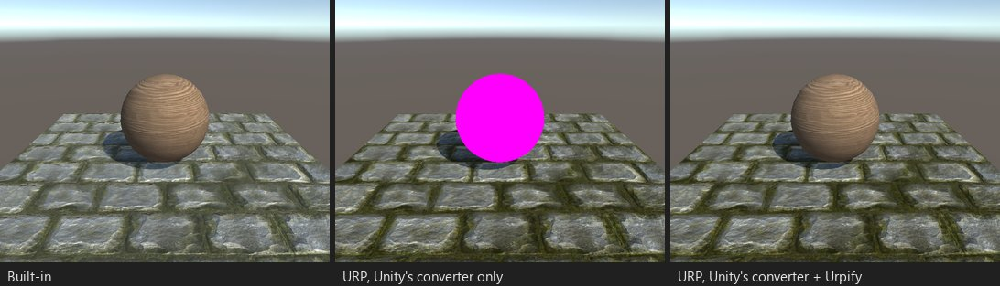

# Lit vert/frag shaders

*Lab booth V02: ForwardBase and ForwardAdd passes, `SHADOW_ATTENUATION` and a shadow caster.*

## What breaks

URP renders passes tagged `ForwardBase`, `ForwardAdd`, `Vertex`, `VertexLM` or `PrepassBase` with the error shader, so the
object is pink. Built-in's light variables (`_LightColor0`, `_WorldSpaceLightPos0`), shadow macros (`SHADOW_COORDS`,
`TRANSFER_SHADOW`, `SHADOW_ATTENUATION`, `UNITY_LIGHT_ATTENUATION`) and `UsePass "Legacy Shaders/VertexLit/SHADOWCASTER"`
have no URP counterpart.

Findings: "ForwardBase pass", "ForwardAdd pass", "Built-in ShadowCaster pass", "LightMode ...", "UsePass ...".

## What Urpify does (Pro)

| Built-in | URP |
|---|---|
| `ForwardBase` | `UniversalForward`; lighting, shadows and ambient come from URP through Built-in's names |
| `ForwardAdd` | A loop over URP's additional lights inside the forward pass, calling the author's fragment code once per light and adding the results |
| `ShadowCaster` | URP's `ShadowCaster` with `ApplyShadowBias`, the author's vertex code kept; a `DepthOnly` copy renders the depth prepass |
| `UsePass "Legacy Shaders/VertexLit/SHADOWCASTER"` | A generated shadow caster pass |
| `UsePass` from another shader of the project | The pass is copied in and converted with the rest |
| `Vertex`, `VertexLM` (vertex-lit only) | `UniversalForward`, lit per vertex by URP's main and additional lights |
| `_LightColor0`, `_WorldSpaceLightPos0` | The light the pass is drawing |
| `UNITY_LIGHT_ATTENUATION`, `SHADOW_ATTENUATION`, `LIGHT_ATTENUATION` | URP's shadow and distance attenuation |
| `ShadeSH9`, `UNITY_FOG_*`, `UnityObjectToClipPos` and the rest of `UnityCG.cginc` | Urpify's library, `BirpCompat.hlsl` |

The author's `vert` and `frag` are copied unchanged. CG blocks become HLSL blocks, `fixed` becomes `half`, and
`sampler2D`/`tex2D` stay as they are: they compile on URP 14 and 17.

## How close

`Auto` for a ForwardBase pass alone, `AutoApprox` with ForwardAdd: Built-in blends each additional light in its own pass,
URP adds them in one. Per-vertex lights that Built-in hands to ForwardBase (`Shade4PointLights`) are drawn per pixel by
the loop instead.
