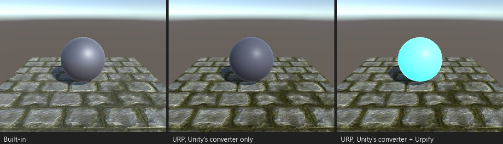

# Command Buffer an Kameraereignissen

*Stand C03: eine leuchtende Hülle, gezeichnet von einem `CommandBuffer`, der der Kamera bei
`CameraEvent.AfterForwardAlpha` hinzugefügt wurde.*

## Was kaputtgeht

URP ignoriert `Camera.AddCommandBuffer`: Was der Buffer zeichnet, verschwindet ohne Meldung.

Befund: „CommandBuffer bei ...“ (`SCRIPT.COMMANDBUFFER.CAMERA`).

## Was Urpify tut (Pro)

`camera.AddCommandBuffer(evt, cb)` wird zu `camera.AddCommandBufferInUrp(evt, cb)` (ebenso für `RemoveCommandBuffer`).
Urpifys Renderer Feature Built-in Camera Hooks führt den Buffer beim URP-Ereignis aus, das dem Built-in-Ereignis
entspricht:

| `CameraEvent` von Built-in | `RenderPassEvent` von URP |
|---|---|
| `BeforeDepthTexture`, `AfterDepthTexture` | `BeforeRenderingPrePasses`, `AfterRenderingPrePasses` |
| `BeforeForwardOpaque`, `AfterForwardOpaque` | `BeforeRenderingOpaques`, `AfterRenderingOpaques` |
| `BeforeSkybox`, `AfterSkybox` | `BeforeRenderingSkybox`, `AfterRenderingSkybox` |
| `BeforeForwardAlpha`, `AfterForwardAlpha` | `BeforeRenderingTransparents`, `AfterRenderingTransparents` |
| `BeforeImageEffectsOpaque`, `AfterImageEffectsOpaque` | `AfterRenderingSkybox` |
| `BeforeImageEffects`, `AfterImageEffects`, `AfterEverything` | `BeforeRenderingPostProcessing`, nach dem Post-Processing, `AfterRendering` |
| Ereignisse des Deferred-Pfads (`BeforeGBuffer`, `AfterLighting` und weitere) | um die undurchsichtigen Objekte herum, der nächste Punkt, den der Forward-Renderer von URP hat |

`DrawRenderer`, `DrawMesh`, `Blit`, `SetGlobal*`, temporäre Render Textures, `SetRenderTarget` und `ClearRenderTarget`
laufen so, wie sie aufgezeichnet sind.

## Wie nah

`Auto, angenähert`; Ereignisse des Deferred-Pfads sind ihrer Natur nach angenähert. Command Buffer an Lichtern
(`Light.AddCommandBuffer`) werden noch nicht unterstützt, siehe [Was nicht konvertiert wird](../not-converted.md).
