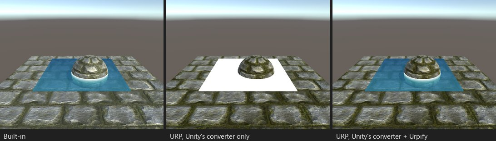

# Tiefentextur

*Stand D01: transparentes Wasser, das `_CameraDepthTexture` für Tiefenfarbe und Schaum um einen Stein liest. Nur nach dem
Konverter von Unity wird das Wasser weiß.*

## Was kaputtgeht

Ein Shader, der `_CameraDepthTexture` liest, bekommt Tiefe nur, wenn Depth Texture im URP Asset eingeschaltet ist. Der
Konverter von Unity schaltet sie nur auf Qualitätsstufen ein, die Soft Particles hatten. Ein transparenter Shader hat ein
zweites Problem: URP kopiert die Tiefe standardmäßig nach den transparenten Objekten, und der Konverter von Unity lässt das
so. Unter Unity 6 bekommt ein solcher Shader dann gar keine Tiefe, und das Wasser wird weiß; unter 2022.3 liest er die
Tiefe des letzten Bildes, daher sehen Standbilder richtig aus, aber bewegte Objekte ziehen eine Spur.

Befunde: „Liest _CameraDepthTexture“ (`SHADER.DEPTH_TEXTURE`), „Transparent, liest ...“
(`SHADER.DEPTH_TEXTURE_TRANSPARENT`).

## Was Urpify tut

- **Free und Pro:** schaltet Depth Texture in jedem URP Asset ein und stellt für einen transparenten Leser den Depth
  Texture Mode des Renderers auf After Opaques. Ein Shader, den URP so zeichnet, wie er ist, funktioniert dann ohne
  Code-Änderung: Stand D01 wird vom kostenlosen Paket allein behoben.
- **Pro, wenn der Shader konvertiert wird:** Die Deklaration `sampler2D _CameraDepthTexture` des Autors wird durch
  `DeclareDepthTexture.hlsl` von URP ersetzt, und die Lesezugriffe (`tex2D`, `tex2Dproj`, `SAMPLE_DEPTH_TEXTURE`,
  `SAMPLE_DEPTH_TEXTURE_PROJ`) werden zu `SampleSceneDepth`. So funktioniert der Shader auch mit Single-Pass-Instanced-XR,
  wo die Tiefentextur ein Array ist. `LinearEyeDepth`, `Linear01Depth` und `COMPUTE_EYEDEPTH` kommen aus Urpifys
  Bibliothek.

## Wie nah

`Auto`. Lässt sich ein Lesezugriff nicht umschreiben, bleibt die Deklaration des Autors, und der Befund sagt, dass
Single-Pass-Instanced-XR für diesen Shader nicht unterstützt wird.
