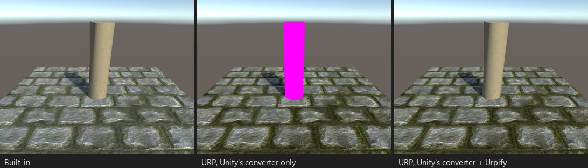
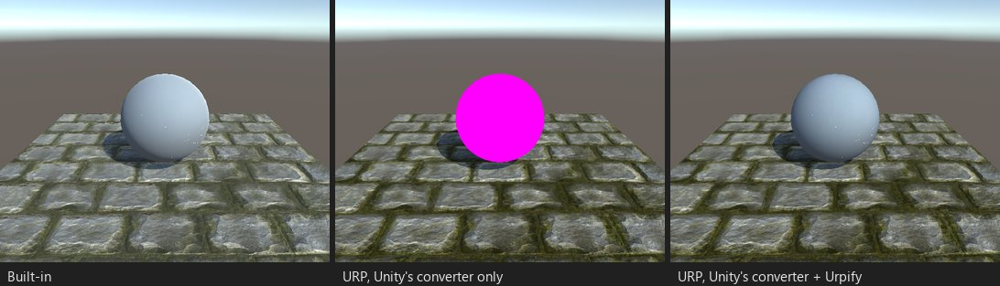
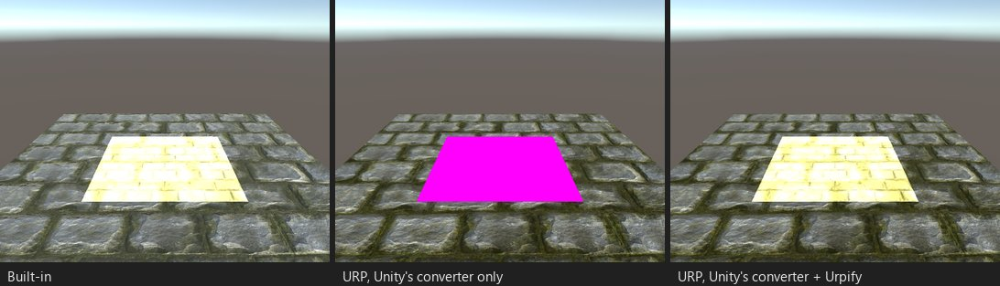
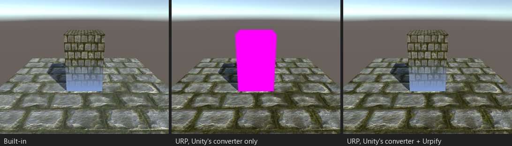

# Optionen von Surface-Shadern

`#pragma surface surf Standard <Optionen>` ändert, was Unity erzeugt. Urpify liest jede Option und behält ihre Bedeutung
in den Passes, die es schreibt (Pro).

*S03: `vertex:vert` biegt das Mesh wie Wind. Die Vertex-Funktion läuft in jedem Pass, daher biegt sich auch der Schatten.*

*S08: Auflösen mit `clip()` und `addshadow`: Der Schatten wird genauso beschnitten.*

*S10: `decal:add`, eine additive Schicht über undurchsichtigen Objekten.*

*S11: Höhennebel in `finalcolor:`, nach der Beleuchtung angewendet, wie in Built-in.*

## Optionen und was aus ihnen wird

| Option | In URP |
|---|---|
| `vertex:func` | Läuft in jedem erzeugten Pass: Forward, Schatten, Tiefe, Depth-Normals, Meta. Zusätzliche `Input`-Felder, die sie füllt, gehen an die Surface-Funktion. |
| `finalcolor:func` | Wird mit der beleuchteten Farbe aufgerufen, vor dem Nebel. |
| `finalgbuffer:func` | Nicht verwendet: Läuft nur im Deferred-G-Buffer-Pass von Built-in. Ein Hinweis sagt das. |
| `alpha`, `alpha:blend`, `alpha:fade`, `alpha:premul` | Transparente Queue und das passende Blending; `premul` behält das vormultiplizierte Specular. |
| `alphatest:prop` | `clip()` gegen die Eigenschaft, in jedem Pass. |
| `keepalpha` | Das Alpha der Surface-Funktion wird auch in undurchsichtigen Passes geschrieben. |
| `decal:add`, `decal:blend` | Wird nach undurchsichtigen Objekten mit additivem oder Alpha-Blending gezeichnet, ohne Schatten. |
| `addshadow` | Der Schatten-Pass führt die Vertex-Funktion und das Surface-Clipping aus, wie der Forward-Pass. |
| `noshadow` | Kein Schatten-Pass; der Forward-Pass empfängt keine Schatten. |
| `noambient`, `novertexlights`, `nolightmap`, `nofog`, `nometa`, `noforwardadd` | Der entsprechende Teil fällt weg: Umgebungslicht, Lichter pro Vertex, Lightmaps, Nebel, der Meta-Pass, zusätzliche Lichter. |
| `halfasview`, `interpolateview`, `approxview`, `dualforward` | Qualitätsschalter für die Blickrichtung, die URP nicht braucht; mit Hinweis ignoriert. |
| `fullforwardshadows`, `nodynlightmap`, `nodirlightmap`, `nolppv`, `noshadowmask`, `noinstancing`, `exclude_path:*`, `dithercrossfade` | Erkannt; das entscheiden URPs eigene Einstellungen (Schatten zusätzlicher Lichter, Lightmap-Modi, Light Probe Proxy Volumes, LOD-Crossfade), daher ändern sie am konvertierten Shader nichts. |
| `tessellate:func`, `tessphong:` | Siehe [Tessellation](surface-tessellation.md). |

Eine Option, die Urpify nicht kennt, wird im Befund „Nicht unterstützte Surface-Optionen“
(`SHADER.SURFACE.UNKNOWN_OPTION`) aufgeführt; der Rest des Shaders wird trotzdem konvertiert.

Die Einstellung „Schatten“ (Project Settings > Urpify) kann Schatten für alle konvertierten Surface-Shader erzwingen oder
abschalten.
