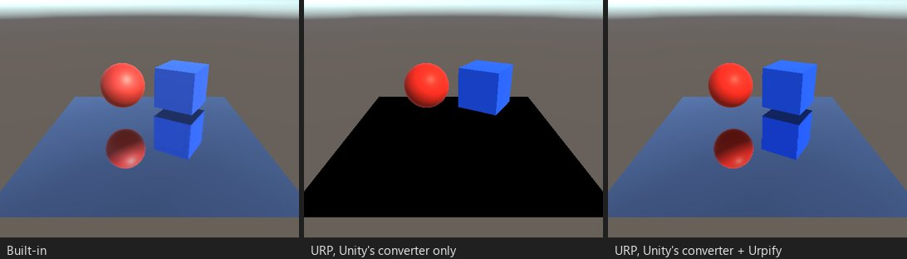

# Scripts que renderizan cámaras: espejos, portales, reflejos del agua

*Puesto M01: un espejo plano escrito como lo hacen MirrorReflection y Standard Assets Water: `OnWillRenderObject`,
`Camera.current`, una cámara de reflejo con plano cercano oblicuo y `Camera.Render`. Solo tras el conversor de Unity, el
espejo es negro.*

## Qué se rompe

URP nunca llama a `OnPreCull`, `OnPreRender` ni `OnPostRender` de una cámara, y llama a `OnWillRenderObject` durante el
culling, donde ninguna otra cámara puede renderizar. Los portales y espejos que renderizan una segunda cámara en esos
métodos muestran una superficie plana o negra. No hay ningún error. Comprobado en URP 14 y 17.

Hallazgos: «OnPreCull en una cámara» y otros (`SCRIPT.CAMERA_CALLBACKS`), «OnWillRenderObject renderiza una cámara»
(`SCRIPT.WILLRENDER_CAMERA`).

## Qué hace Urpify (Pro)

El script conserva sus métodos y su lógica. Urpify lo registra en los eventos de cámara de URP:

- `OnPreCull` y `OnPreRender` se llaman desde `RenderPipelineManager.beginCameraRendering` de su cámara, `OnPostRender`
  desde `endCameraRendering`.
- `OnWillRenderObject` se llama antes del culling de la cámara de URP para los renderers que la cámara ve, con
  `Camera.current` apuntando a esa cámara.
- `Camera.Render()` dentro de ellos renderiza en el fotograma de URP mediante una petición de render, así que la textura
  del reflejo o del portal está lista antes de que la dibuje la cámara que la muestra.
- `OnRenderObject` se llama tras los objetos opacos y transparentes de la cámara.

El catálogo de Urpify reconoce scripts conocidos: Portals de SebLague, MirrorReflection, Standard Assets Water y la cámara
de normales de ToonWaterShader se convierten con recetas comprobadas en esos proyectos. Los demás usan el mismo mecanismo
y reciben «Automático, aproximado».

## Cuánto se acerca

`Auto` para las recetas comprobadas del catálogo, `Automático, aproximado` para los demás: revisa esas escenas en la
comparación de escenas. Una diferencia con Built-in: `OnWillRenderObject` se llama para los renderers dentro del frustum
de la cámara sin occlusion culling, así que un espejo oculto tras una pared renderiza igualmente su reflejo.

El código añadido a los delegados `Camera.onPreCull`, `Camera.onPreRender` y `Camera.onPostRender` aún no se convierte;
el hallazgo dice cómo moverlo. Un `OnRenderImage` que renderiza una cámara no se ejecuta en URP, consulta
[Qué no se convierte](../not-converted.md).
