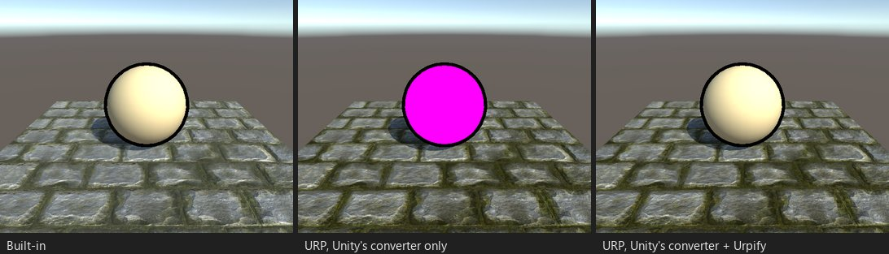

# Pasadas extra: contornos, capas, envolturas

*Puesto S12: un surface shader toon con una pasada de contorno escrita a mano. Solo tras el conversor de Unity queda de él
un contorno alrededor de una esfera rosa.*

## Qué se rompe

URP dibuja como mucho dos pasadas de un SubShader por objeto: una `SRPDefaultUnlit` y una `UniversalForward`, en ese
orden. Built-in dibuja todas las pasadas. Un shader con una pasada de contorno junto a su pasada de iluminación, capas de
pelo, capas de sombreado o dos pasadas sin etiqueta LightMode conserva solo una de ellas, a menudo sin avisar.

Hallazgos: «Pasadas extra junto a un programa surface» (`SHADER.SURFACE.EXTRA_PASS`), «Pasadas sin LightMode: N»
(`SHADER.PASS.MULTIPLE_UNTAGGED`).

## Qué hace Urpify (Pro)

- **Dos pasadas dibujadas:** la primera pasa a ser `SRPDefaultUnlit` y la segunda `UniversalForward`, así que se mantiene
  el orden de dibujo de Built-in. Comprobado en URP 14 y 17.
- **Tres o más pasadas dibujadas:** a partir de la tercera reciben las etiquetas `UrpifyPass3`, `UrpifyPass4` y así
  sucesivamente. El Renderer Feature Built-in Camera Hooks de Urpify las dibuja tras los objetos opacos o transparentes de
  URP, las pasadas de cada objeto en orden. Hasta 32 pasadas dibujadas por SubShader.
- **Las pasadas escritas a mano junto a un programa surface** se conservan y se convierten con las reglas de vert/frag.
- Los shaders de efectos de imagen que dibuja `Graphics.Blit` no reciben etiquetas: sus pasadas se eligen por índice.

El Renderer Feature se añade en el paso Conversores de Urpify a cada renderer de URP que lo necesita.

## Cuánto se acerca

`Auto` para dos pasadas, `Automático, aproximado` para tres o más. Si hay varios de esos objetos en pantalla, las dos
primeras pasadas de cada objeto se dibujan antes que las pasadas extra de cualquier objeto, lo que puede cambiar el orden
de objetos superpuestos.
