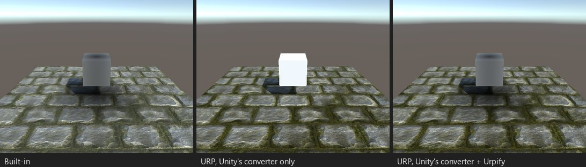

# Proyectores

*Puesto C01: un componente `Projector` proyecta una mancha de sombra bajo un cubo. Solo tras el conversor de Unity no hay
sombra.*

## Qué se rompe

URP no renderiza componentes `Projector`. Las manchas de sombra, los anillos de selección y los decals proyectados
desaparecen sin avisar.

Hallazgos: «Projector en ...» (`SCENE.PROJECTOR`), «Shader de proyector» (`SHADER.PROJECTOR`).

## Qué hace Urpify (Pro)

El `Projector` sigue siendo un proyector y su shader se queda tal cual. El Renderer Feature Built-in Camera Hooks de
Urpify dibuja el material de cada proyector activo sobre los renderers dentro de su frustum y sus capas, con
`unity_Projector` y `unity_ProjectorClip` establecidos por objeto, como en Built-in. El tamaño, la orientación, el
alcance, las capas ignoradas y el material vienen del componente, así que editas los proyectores como hasta ahora.

El feature mantiene una caché de los proyectores y de los renderers que alcanzan, en lugar de buscar en la escena en cada
fotograma: los proyectores se actualizan cada 30 fotogramas y los renderers cada 60, y ambos al cargar o descargar una
escena. Los renderers se descartan con el frustum de cada proyector y de la cámara. Medido en Unity 6.5 con un proyector:
0,02 ms por fotograma con 88 renderers; con 5000 renderers más, unos 2,2 ms cuando todos están delante de la cámara y
0,09 ms cuando están detrás.

Como nada cambia en el proyector ni en su shader, un paquete exportado con Mantener compatibilidad con Built-in sigue
funcionando en ambas pipelines.

## Cuánto se acerca

`Automático, aproximado`: el mismo shader sobre los mismos objetos. No se usa el Decal Projector propio de URP, así que el
aspecto sigue siendo el de Built-in.
