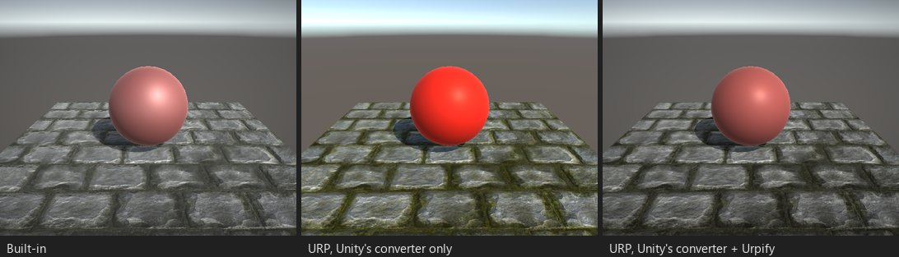

# 画像エフェクト：OnRenderImage

*ブース C02：`OnRenderImage` によるポストエフェクト（彩度を下げてビネット）。Unity のコンバーターだけを通すと、エフェクト
はエラーなしで消えます。*

## 何が壊れるか

URP は `OnRenderImage` を一度も呼ばないため、Built-in 向けに書いた画像エフェクトはすべて動かなくなります。エラーもピンクも
なく、ゲームの見た目が変わるだけです。URP 14 と 17 で確認済み。

検出結果：「OnRenderImage（Blit 呼び出し {0} 回）」（`SCRIPT.ONRENDERIMAGE`）、深刻度「エラーなしで壊れる」。エフェクトの
シェーダーには検出結果「画像エフェクトのシェーダー」が付きます。

## Urpify の対処（Pro）

スクリプトはカメラの MonoBehaviour のままで、引き続き操作盤として働きます：フィールド、毎フレーム設定する値、マテリアルは
変わりません。Urpify の Built-in Camera Hooks レンダラー機能が、設定で選んだ URP フレーム内の位置（「画面エフェクトの挿入
位置」：既定はポストプロセスの後）で、カメラの色を入力としてスクリプトの `OnRenderImage` を呼びます。スクリプトの
`Graphics.Blit` 呼び出しは `ImageEffectGraphics` を通り、同じマテリアル、パス、一時レンダーテクスチャで、同じ順に URP の
フレームに記録されます。`[ImageEffectOpaque]` 付きのエフェクトは Built-in と同じくスカイの後に実行されます。1 つのカメラ
にある複数のエフェクトは順序を保ちます。`OnRenderImage` 内の `GL` による描画（クアッド、行列、クリア）も記録されます。

エフェクトのシェーダーはそのままです：エフェクトは Built-in と同じく画面を `_MainTex` に渡し続けるので、`vert_img`、
`v2f_img`、`_MainTex` は動きます。

## どこまで近いか

Blit が 1 つなら `自動`、チェーンやコマンドバッファーなら `自動（近似）`。`Graphics.DrawMeshNow` などで即時描画する
エフェクトや、カメラを描画する（`Camera.Render`）エフェクトは URP のフレームに記録できません：検出結果に組み直し方が
書かれています。

エフェクトが呼び出す他のスクリプトの `Graphics.Blit` 呼び出し（カメラスクリプトの背後にある ScriptableObject のエフェクト、
チェーンを実行するマネージャー）も同じように記録されます。チェーンがカメラを描画する、コンピュートシェーダーを
ディスパッチする、または Built-in の G バッファー（`_CameraGBufferTexture0-3`）を読むエフェクトは、そのまま残します
（未対応）。URP ではエフェクトが欠け、フレームの残りは描画されます。移行後にシーンのフレームがほぼ単色になった場合、
そのシーンのエフェクトは要確認になります。カメラ上で無効にして原因を特定するか、ロールバックしてください。

ビルドしたプレイヤーでもエフェクトは保たれます：Urpify が名前で呼ぶものはすべてコードストリッピングから保護されており、
Mono と IL2CPP のビルドで確認済みです。
