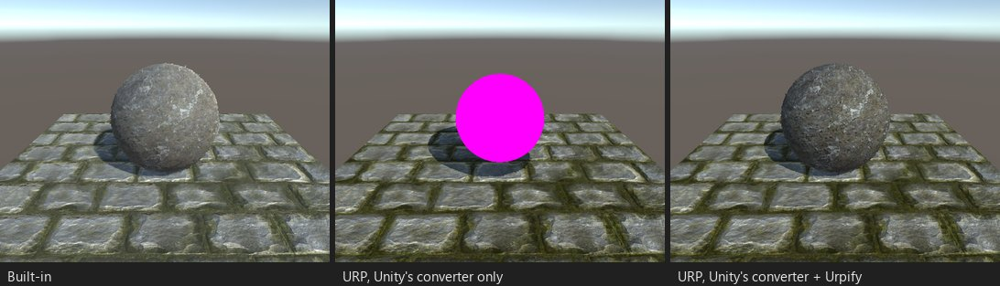

# テッセレーション

*ブース S09：`tessellate:` とディスプレイスメントを使うサーフェスシェーダー。*

## 何が壊れるか

`tessellate:func` は、サーフェスシェーダー用のハルとドメインのステージを Unity に生成させます。URP にはサーフェス
シェーダーがないので、オブジェクトはピンクになります。

検出結果：「テッセレーション（...）」（`SHADER.SURFACE.TESSELLATION`）。

## Urpify の対処（Pro）

コンバーターは、組み込みパイプラインに倣ったテンプレートでハルとドメインのステージを生成します：作者のテッセレーション
関数が係数を与え、分割は `fractional_odd`、続いて `vertex:` 関数が新しい頂点を動かします。オブジェクトを描画するすべての
パス（フォワード、影、深度）がテッセレーションされるので、影も変位した表面に従います。`tessphong:` は指定した強さの
Phong スムージングを加えます。

独自のハルとドメインのステージを書いた vert/frag シェーダーはそれを保ちます。Built-in が定義する属性（`UNITY_domain`、
`UNITY_partitioning`、`UNITY_outputtopology`、`UNITY_patchconstantfunc`、`UNITY_outputcontrolpoints`）は Urpify の
ライブラリから提供され、コンパイルチェックはハルとドメインのステージも対象にします。

## どこまで近いか

`自動（近似）`：同じ係数と同じ変位に、URP のライティングが加わります。
