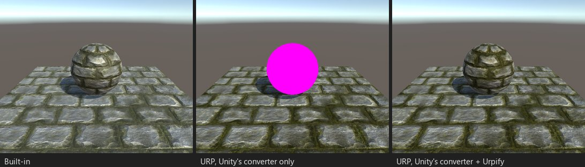
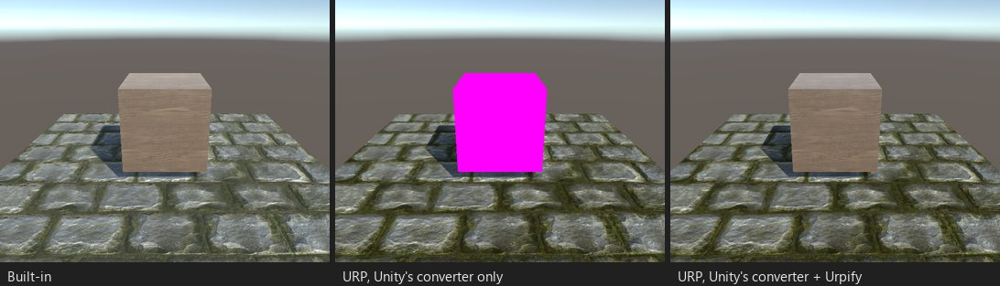
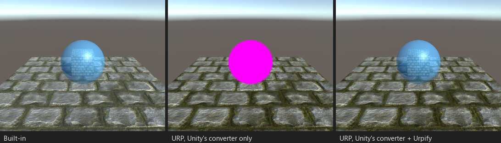

# 서피스 셰이더

*부스 S01: Standard 라이팅 모델, 알베도, 노멀 맵, 오클루전을 쓰는 서피스 셰이더.*

## 무엇이 깨지는가

`#pragma surface`는 내장 파이프라인의 기능입니다: Unity가 서피스 함수로부터 셰이더의 패스(ForwardBase, ForwardAdd,
ShadowCaster, Deferred, Meta)를 생성합니다. URP에는 서피스 셰이더가 없어 이 패스들이 오류 셰이더로 그려지므로, 그런
셰이더를 쓰는 모든 오브젝트가 분홍색이 됩니다. Unity 컨버터는 커스텀 셰이더를 건드리지 않습니다.

발견 사항: "서피스 셰이더, 라이팅 ..."(`SHADER.SURFACE`), 심각도 "분홍색으로 렌더링".

## Urpify가 하는 일(Pro)

컨버터는 작성자의 서피스 함수를 그대로 복사하고, 그 주위에 URP가 필요로 하는 패스를 씁니다.

| 패스 | 바탕 |
|---|---|
| `UniversalForward` | 서피스 함수, 이어서 라이팅 모델에 맞는 URP 라이팅 |
| `ShadowCaster` | 같은 정점 코드에 URP의 그림자 바이어스 |
| `DepthOnly`, `DepthNormals` | 같은 정점 코드. 깊이 텍스처, 깊이 프라이밍, SSAO용 |
| `Meta` | 서피스 함수의 알베도와 이미시브. 라이트맵 베이크용 |

| 라이팅 모델 | URP의 라이팅 |
|---|---|
| `Standard`, `StandardSpecular` | `UniversalFragmentPBR`, 메탈릭 또는 스페큘러 워크플로 |
| `Lambert`, `BlinnPhong` | Urpify 라이브러리에 있는 Built-in의 `LightingLambert`와 `LightingBlinnPhong`. 메인 라이트와 각 추가 라이트에 적용 |
| 직접 만든 `Lighting<Name>` | 그 함수. [커스텀 라이팅](surface-custom-lighting.md) 참고 |

`Input` 구조체는 Built-in과 같은 방식으로 채워집니다: 텍스처 타일링이 적용된 `uv_`와 `uv2_` 좌표, `worldPos`,
`worldNormal`, `worldRefl`, `viewDir`, `screenPos`, `color : COLOR`, `facing : VFACE`, `WorldNormalVector`와 함께 쓰는
`INTERNAL_DATA`, 그리고 `vertex:` 함수가 채우는 필드. 머티리얼 프로퍼티는 SRP Batcher를 위해 `UnityPerMaterial`로 옮겨지고,
셰이더 이름과 프로퍼티 이름은 그대로이므로 머티리얼은 값을 유지합니다.

여러 `SubShader` 블록과 LOD는 의미를 유지합니다. 내장 셰이더를 가리키는 `Fallback`은 해당하는 URP 셰이더를 가리키게
됩니다.

## 얼마나 가까운가

Standard, StandardSpecular, Lambert, BlinnPhong은 `자동`입니다: URP 자체 라이팅의 차이([URP에서 달라 보이는 점](../urp-differences.md))
를 빼면 결과가 Built-in과 일치합니다. 변환된 모든 셰이더는 구를 써서 Built-in과 URP에서도 렌더링되며, 구의 25 %를 넘는
부분이 바뀌면 `검토`로 표시됩니다.

*S02: StandardSpecular.*

*S04: `alpha:fade`를 쓰는 BlinnPhong, 투명한 구.*
