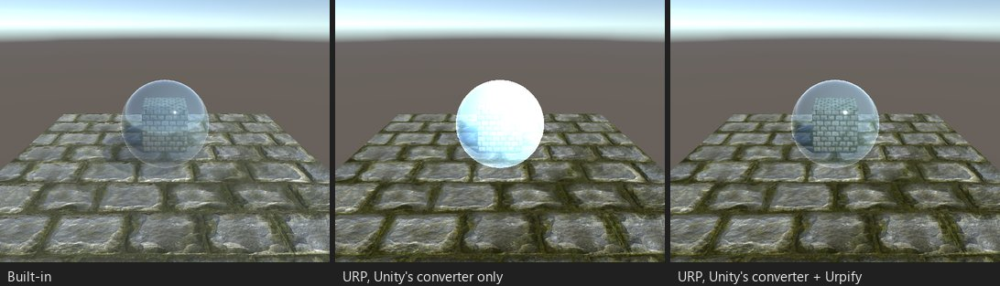
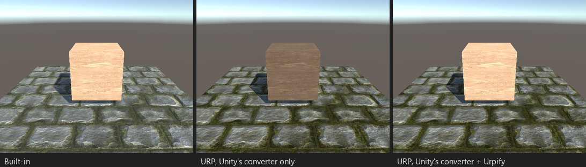

# Исправления после конвертера Unity

Render Pipeline Converter от Unity — первое, что выполняет миграция, и чаще всего он прав. Ниже случаи, где его
результат измеримо неверен, и что делает после него бесплатный пакет. Всё это — в бесплатном пакете, на шаге
«Конвертеры Urpify».

## Standard в режиме Transparent

*STD04: стекло в режиме Transparent шейдера Standard.*

Конвертер Unity переводит Transparent в смешивание Premultiply из URP, которое ожидает цвета, уже умноженные на альфу.
Стекло становится почти непрозрачным и белым. Urpify переключает материал на смешивание Alpha с Preserve Specular
Lighting — так его смешивает Built-in. Находка: «..., режим Transparent» (`MATERIAL.STANDARD_TRANSPARENT`).

## Legacy Self-Illumin

*LEG03: `Legacy Shaders/Self-Illumin/Diffuse`.*

Конвертер Unity переводит такие материалы в Simple Lit, который не берёт свечение из альфы Illumin: свечение пропадает.
Urpify переводит их на свой шейдер Self-Illumin для URP, который светится как в Built-in. Находка: `MATERIAL.SELF_ILLUMIN`.

## Встроенные материалы редактора

Рендереры со встроенными `Default-Material` или `Default-Diffuse` редактора (новый куб, плоскость) конвертер Unity
направляет на материал URP по умолчанию, который серый, а не белый. Urpify направляет их на копии для URP со значениями
встроенного материала. Находка: `SCENE.BUILTIN_MATERIAL`.

## Материалы внутри пакетов

Файлы пакета доступны только для чтения, поэтому конвертер Unity никогда не меняет материал, который лежит в пакете. Если
его шейдер только для Built-in, каждый рендерер с ним становится розовым: стены ProBuilder 5 используют
`ProBuilderDefault.mat`, шейдер которого `ProBuilder/Standard Vertex Color` — surface-шейдер. Urpify направляет такие
рендереры в сценах и префабах на копию для URP в `Assets/Urpify/Materials/Packages/`: для встроенного шейдера — через
собственный апгрейдер Unity (`Авто`), иначе URP Lit с цветом, текстурой, гладкостью и металличностью материала
(`Авто, приблизительно`: то, что добавляет сам шейдер, например цвета вершин, не сохраняется). Находка:
`SCENE.PACKAGE_MATERIAL`.

## Встроенные шейдеры без правила перевода

У некоторых встроенных шейдеров в конвертере Unity нет правила перевода («No upgrader found»): `Legacy Shaders/Decal`,
`Legacy Shaders/Transparent/VertexLit`, `Transparent/Parallax Diffuse` и `Specular`, а на URP 14 — ещё два правила,
записанные под старыми именами. Urpify переводит такие материалы на ближайший шейдер URP из своей таблицы, с переносом
свойств. Находка: `MATERIAL.BUILTIN_NO_UPGRADER`.

## Post-processing Stack v2

Конвертер Unity превращает тома и профили PPv2 в Volume URP, но в пакетном режиме не дожидается нужного ему поиска
ассетов и не переводит ни одного: bloom пропадает без ошибки. Шаг «Конвертер Unity» в Urpify дожидается поиска, затем
переносит параметры Bloom с калибровкой (threshold и scatter), чтобы свечение было ближе к Built-in. Остальная разница —
сам bloom URP, см. [Чем URP отличается на вид](../urp-differences.md). Находка: `SCENE.PPV2`.

## Настройки URP Asset

- **Depth Texture и Opaque Texture** включаются во всех URP Asset, когда их читает шейдер, который URP рисует как есть
  (см. [Текстура глубины](depth-texture.md)).
- **Текстуры URP Asset** (URP 14): конвертер Unity сохраняет свои URP Asset с пустыми текстурами blue noise и Bayer.
  Редактор их заполняет, собранная игра — нет: она бросает `NullReferenceException` каждый кадр и рисует чёрный экран.
  Urpify заполняет их из пакета URP. Находка: `SETTINGS.URP_ASSET_TEXTURES`.
- **Основной свет**: на уровнях качества с Pixel Light Count = 0 Built-in всё равно освещал основной направленный свет
  попиксельно; Urpify ставит там Main Light в URP на Per Pixel.

## Material Variants

Конвертер Unity переводит Material Variant на шейдер URP родителя, но теряет собственные значения варианта: он становится
молчаливой копией родителя. Urpify читает собственные значения варианта из бэкапа шага «Конвертер Unity» и возвращает их
как переопределения свойств URP. Находка: `MATERIAL.VARIANT`.

## Материалы внутри моделей, только для чтения

Материалы, встроенные в FBX, доступны только для чтения, а модуль конвертера Unity для них ненадёжно работал в пакетном
режиме. Urpify запускает этот модуль объект за объектом для найденных рендереров и террейнов, на обеих версиях Unity.
