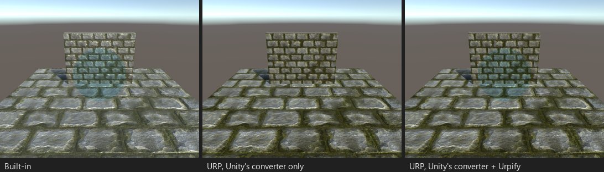
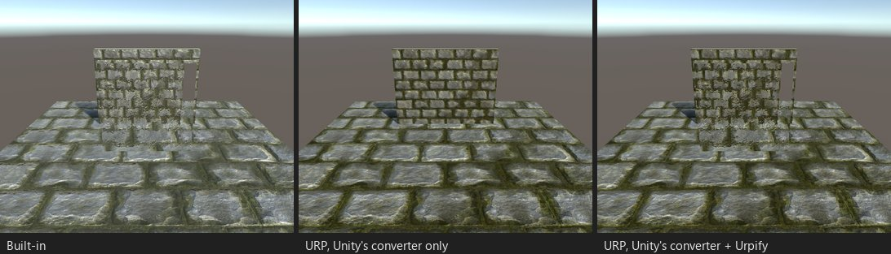

# GrabPass

*Стенд G01: стекло с преломлением и безымянным `GrabPass {}`. Только после конвертера Unity стекло пропадает — без ошибки.*

*Стенд G02: марево от жара с именованным `GrabPass { "_HazeBackground" }`.*

## Что ломается

В URP нет GrabPass. Проход, захватывающий экран, пропускается, текстура остаётся пустой, и объект пропадает или теряет
преломление. Ни розового, ни ошибки: тихая поломка.

Находка: «GrabPass (...)» (`SHADER.GRABPASS`), серьёзность «Сломается без ошибки».

## Что делает Urpify (Pro)

GrabPass убирается, а текстура, которую он заполнял (`_GrabTexture` или именованная), читает вместо этого копию экрана:

- **Источник GrabPass = Opaque Texture** (по умолчанию): `_CameraOpaqueTexture` из URP, снятая после непрозрачных объектов
  и неба, до прозрачных. Urpify включает Opaque Texture во всех URP Asset, без уменьшения разрешения.
- **Источник GrabPass = После прозрачных**: Renderer Feature Built-in Camera Hooks от Urpify копирует экран после
  прозрачных объектов в `_UrpifyGrabTexture`, затем рисует объекты с GrabPass (тег `UrpifyGrabPass`), как делал GrabPass
  в Built-in. Ещё одна копия экрана за кадр.

GrabPass, стоящий после одного-двух проходов того же шейдера (туман, затем размытие, читающее захват), читает копию,
снятую после этих проходов, поэтому видит то же, что видел захват Built-in.

## Насколько близко

`Авто, приблизительно` с Opaque Texture: прозрачных объектов за стеклом в преломлении нет. С «После прозрачных» результат
совпадает с Built-in. Несколько GrabPass с разными текстурами в одном шейдере пока не поддерживаются: в URP одна Opaque
Texture.

На 2022.3 самопроверка Urpify рендерит шейдеры с GrabPass игровой камерой: URP 14 не копирует Opaque Texture для
превью-камеры.
