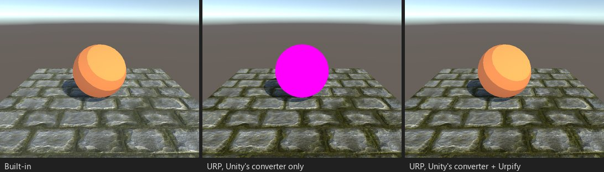

# Свои функции освещения

*Стенд S05: surface-шейдер со своей функцией освещения, toon-рампой.*

## Что ломается

Surface-шейдер может назвать свою модель освещения, `#pragma surface surf Toon`, и определить `LightingToon`. Built-in
вызывает её по разу на каждый источник: в ForwardBase для основного и в ForwardAdd для каждого дополнительного, с
`_LightColor0` и затуханием источника. В URP surface-шейдеров нет, поэтому объект розовый.

Находка: «Своя функция освещения ...» (`SHADER.SURFACE.CUSTOM_LIGHTING`).

## Что делает Urpify (Pro)

Функция автора копируется без изменений. Сгенерированный forward-проход вызывает её для основного света URP, затем для
каждого дополнительного, с тенями и затуханием URP, и складывает результаты, как это делали два прохода Built-in. Внутри
функции `_LightColor0` — цвет того источника, для которого она вызвана.

Распознаются все сигнатуры встроенного конвейера:

| Сигнатура | Пример |
|---|---|
| Без направления взгляда | `half4 LightingToon(SurfaceOutput s, half3 lightDir, half atten)` |
| С направлением взгляда | `half4 LightingToon(SurfaceOutput s, half3 lightDir, half3 viewDir, half atten)` |
| С глобальным освещением | `half4 LightingToon(SurfaceOutput s, half3 viewDir, UnityGI gi)` и её `LightingToon_GI` |
| Варианты deferred и prepass | `_Deferred`, `_PrePass`: не используются, URP рисует в forward |

Функция находится везде, где её нашёл бы компилятор: в программе, в блоках `CGINCLUDE`, в include-файлах проекта на любой
глубине и в макросах `#define`, объявляющих функции.

## Насколько близко

`Авто, приблизительно`. Built-in добавляет каждый дополнительный источник своим проходом с аддитивным смешиванием; URP
освещает их в одном проходе. Для непрозрачных объектов суммы совпадают; у прозрачных шейдеров может отличаться там, где
источники перекрываются. Рассеянный свет берётся из сферических гармоник URP, как в Built-in.

Если функции нет ни в шейдере, ни в просканированных include-файлах, находка называет её, и шейдер не переводится, пока
её include-файл не попадёт в область сканирования.
