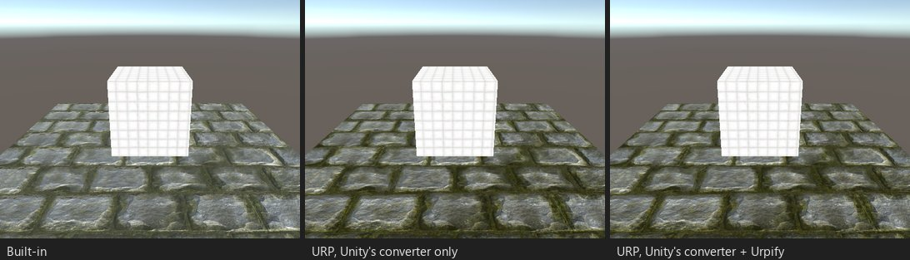

# Неосвещённые vert/frag-шейдеры

*Стенд V01: неосвещённый CG-шейдер с туманом и прокруткой UV. URP рисует его как есть.*

## Что происходит

Vert/frag-шейдер без тега LightMode или с `Always` часто рисуется в URP без изменений: проход без тега LightMode URP
рисует как `SRPDefaultUnlit`, а CG-код с `UnityCG.cginc` по-прежнему компилируется. Urpify проверяет, что шейдер
компилируется в URP, и не трогает его, если это так.

Находка: нет или заметка, что URP рисует шейдер как есть.

Что всё же может сломаться, и у чего есть своя страница:
- два и более прохода без LightMode: [Дополнительные проходы](extra-passes.md);
- чтение `_CameraDepthTexture`: [Текстура глубины](depth-texture.md);
- `GrabPass`: [GrabPass](grabpass.md);
- переменные света Built-in вроде `_LightColor0` в неосвещённом проходе: в URP они равны нулю; Pro отображает их на
  основной свет URP.
