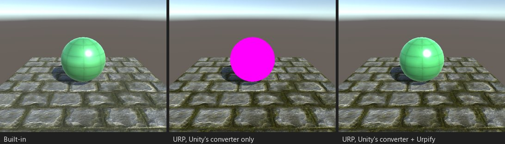

# 使用内置着色器名称的 Shader.Find

*展台 C04：脚本在运行时用 `new Material(Shader.Find("Standard"))` 创建材质并设置 `_Color`。*

## 什么会损坏

Unity 转换器升级的是材质文件，而不是代码。用 `Shader.Find("Standard")`、`"Diffuse"`、`"Legacy Shaders/..."` 或其他内置
着色器名称创建材质的脚本，会得到 URP 无法绘制的着色器，物体变成粉色。脚本设置的属性名（`_MainTex`、`_Color`、
`_Glossiness`）在 URP Lit 中是隐藏属性，因此即使手动替换着色器，这些调用也不会改变任何东西。

发现：`Shader.Find("...")`（`SCRIPT.SHADER_FIND_BUILTIN`）、“代码中的 Built-in 属性名”（`SCRIPT.BUILTIN_PROPERTY_NAMES`）。

## Urpify 的做法（Free）

这是免费包中 Unity 转换器之后的修复之一。在同一个脚本中：

- 着色器名称改为 Unity 转换器为该内置着色器选择的 URP 着色器（`Standard` 改为 `Universal Render Pipeline/Lit`），对于没有
  Unity 规则的着色器，则改为 Urpify 表中最接近的 URP 着色器；
- 同一方法设置的属性名改为 URP 的名称（`_MainTex` 改为 `_BaseMap`，`_Color` 改为 `_BaseColor`）。

使用“保留 Built-in 支持”输出时，每个名称都会在运行时根据当前管线选择，因此脚本在 Built-in 中也能继续工作。

重写后的脚本在保存前会先编译；无法编译时，会恢复原文件并报告。

## 有多接近

`自动`。
