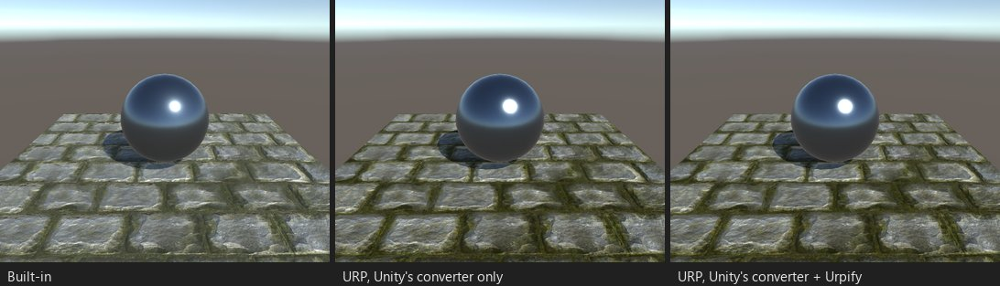
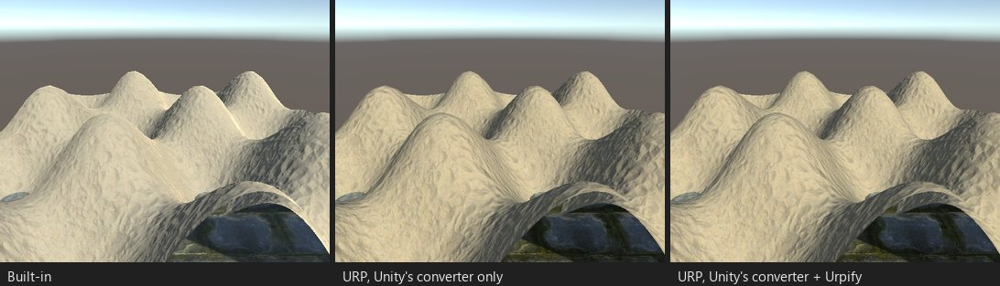

# Unity 转换器能处理的内容

Unity 的 Render Pipeline Converter 会升级使用 Unity 自身内置着色器的材质。Urpify 把它作为迁移中的“运行 Unity 转换器”步骤
运行，附带从脚本可靠运行所需的变通处理，并报告它的日志。

*STD01：Standard，金属工作流，法线贴图和金属度贴图。Unity 转换器将其升级为 URP Lit。*

*TER01：两层地形改用 URP 的地形着色器。*

转换器覆盖的范围，在展台 STD01 至 STD06、LEG01 至 LEG05、PAR01、PAR02、FBX01、FBX02 和 TER01 上测得：

- Opaque、Cutout 和 Fade 模式的 Standard 与 Standard (Specular setup)，带法线、自发光和细节贴图。Transparent 模式是例外，
  参见 [Unity 转换器之后的修复](after-unity-converter.md)。
- Legacy Shaders（Diffuse、Specular、Bumped、Reflective、Transparent、Cutout、Lightmapped、Parallax、VertexLit）；
  Self-Illumin 是例外。
- Mobile 着色器、Unlit/Texture、Particles/Standard Surface 和 Unlit、旧版粒子。
- Nature/Terrain/Standard 和默认地形材质；SpeedTree。
- 嵌入在导入模型中的材质。
- 对 Built-in 材质属性做动画的动画片段（扫描会列出它们；Urpify 暂不检查结果）。
- Post-processing Stack v2，参见 [Unity 转换器之后的修复](after-unity-converter.md)。

Urpify 的扫描把这些材质列为由 Unity 转换器修复，因此概览会把它们与需要 Urpify 的内容分开统计。

## 可靠地运行

在 Unity 6.5 上，Unity 文档中的批处理命令在没有 `-typesFilter` 时会抛出 `NullReferenceException`，并且编辑器常在成功运行后
退出时崩溃（退出码 21、139）。Urpify 通过 API 调用转换器，根据转换器日志和重新扫描而不是退出码来判断结果，并把日志写入报告。
